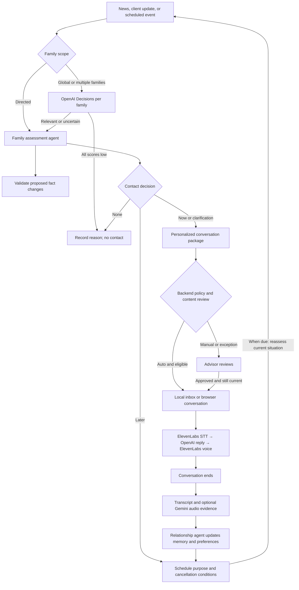

# Sherpas — First to know. First to tell. Thoughtfully.

**Personal financial communication, with the preparation automated and the relationship remembered.**

A headline describes the market. A family needs to understand what it means for their children, their plans, and the decision in front of them. Preparing that answer takes an advisor time: checking the plan, deciding whether contact is useful, choosing the words, and remembering to follow up.

Our prototype connects those steps. It evaluates events for each family, prepares a grounded conversation, applies the advisor's approval policy, speaks through ElevenLabs, and learns from what the client actually says. A concern expressed today can become a thoughtful check-in five days later—even without another headline.

Built for **CDTM Valencia Hacks 2026**, addressing Sherpas' **“First to know, first to tell”** challenge, with ElevenLabs powering the voice experience. The intended business value is **more personal attention per advisor**. We demonstrate the automation that could enable that capacity, without claiming an unmeasured percentage of time saved or improved retention.

The product frontend from `origin/feat/ui-front` is now connected to this local backend on the integration branch `codex/local-setup`. Open [the application](http://127.0.0.1:3000/app/); [operational diagnostics](http://127.0.0.1:3000/ops) remain available separately. The existing frontend layout and visual design are retained. Integration history and implementation boundaries are recorded in [INTEGRATION.md](INTEGRATION.md).

## Hackathon submission

**Complete integrated version: [`codex/local-setup`](https://github.com/arnauquest/CDTM_VLC_HACKS26/tree/codex/local-setup).** The separate `feat/ui-front` branch is the original frontend workspace.

- [Demo video — 2:35, 1080p, with narration and real browser conversation audio](deliverables/sherpas-demo.mp4) (use **View raw / Download raw file** if GitHub does not show a player).
- [Final pitch deck](deliverables/Sherpas-Pitch-Final.pptx): starts with a blank background; the next advance shows the phone notification with embedded sound. The final personalized voice clip is also embedded.
- [Two-speaker script](deliverables/Speaker-script.txt).
- [Demo runbook, actual results and editing disclosures](DEMO.md).

The demo uses the four official synthetic families. External news is simulated and labelled; provider calls, decisions, human voice transcription, Gemini acoustic observations and stored follow-ups are real. API keys, local sessions, databases and raw recordings are intentionally excluded.

## Run locally

Use Node.js 22.13 or newer. The backend uses Node's built-in SQLite and has no npm package dependencies.

```sh
git clone --branch codex/local-setup https://github.com/arnauquest/CDTM_VLC_HACKS26.git
cd CDTM_VLC_HACKS26
git clone https://github.com/SherpasEngineering/hackathon-cdtm-vlc-hacks-2026.git ../sherpas-official-cases
# Preserve an existing .env:
test -f .env || cp .env.example .env
# In .env, set SHERPAS_CASES_DIR=../sherpas-official-cases/cases
# Configure your provider credentials and authenticated Codex CLI (CODEX_BIN).
# Fill the local configuration without committing credentials.
npm start
```

The server binds to loopback, normally `http://127.0.0.1:3000`. The same `npm start` command serves both the API and frontend; `/` redirects to `/app/`. No frontend build or new npm dependencies are required.

A fresh checkout needs your provider credentials and a separately authenticated Codex CLI. OpenAI API keys power relevance and live conversation; the Codex login powers assessment and relationship agents. Use models available to your accounts; `.env.example` records the prototype's configured defaults. Gemini is optional for acoustic analysis. The prepared demo snapshot is local and is not committed: `scripts/demo-restore.sh` is for an existing staged demo, not a fresh installation.

| Local URL | Session |
| --- | --- |
| [Advisor](http://127.0.0.1:3000/app/?role=consultor) | Shared local advisor and real stored work queue. |
| [Administrator](http://127.0.0.1:3000/app/?role=admin) | Local configuration, audit records and integration status. |
| [Michael's client view](http://127.0.0.1:3000/app/?role=cliente&family=michael-carter) | Selected family's plan, updates, chat and browser voice. |
| [Diagnostics](http://127.0.0.1:3000/ops) | Events, jobs, policy, traces and provider diagnostics. |

Use `family=<case-slug>` to select another supplied family, or use the family selector in the client view. Real API mode is the default. Add `?mock=1` (or `&mock=1`) only to inspect the original isolated mock UI.

These are **local demo sessions, not production authentication**. Frontend bearer tokens are stored in tab-scoped `sessionStorage`, with separate role/family keys. Client API access is restricted to the selected family. Tokens expire after 12 hours and disappear from the server when it restarts. Same-origin `/app/` is the recommended setup; development origins on ports 3000 and 5173 remain permitted, with additional exact origins configurable through `ALLOWED_ORIGINS`.

## The complete product loop



### 1. Notice the right event—and know when to stay silent

An event can originate with an advisor, a client update or the scheduler. A directed event goes straight to its family's assessment. Broader events first use **OpenAI Decisions**, evaluating financial relevance, relationship relevance and insufficient evidence separately for each family. Only when all three probabilities fall below the provisional threshold is the family discarded. **Relevance is not permission to send:** it determines whether deeper assessment is useful.

### 2. Understand one family with precise context

The assessment agent receives the event, effective financial facts, original source evidence, household members, goals, relationship memory, preferences, recent contacts, existing follow-ups and policy version. Each job concerns one family. It separates proposed **fact changes** from **contact decisions** (`now`, `later`, `none`, `needs_information`) and explains urgency, review requirements and the recommended channel. A database update does not automatically create a notification.

The backend validates proposals before applying them. Original snapshots, IDs, associations and approvals are not writable through free-form agent instructions. The [exact schemas](backend/agents/contracts.mjs) and [task-specific prompts](backend/agents/prompts.mjs) are included for inspection.

### 3. Prepare the conversation before it starts

The package contains a message, voice script, permitted facts, objectives, anticipated questions and answers, alternative conversation paths, questions to ask, response boundaries and escalation wording. Personalization becomes concrete: **what to explain, how briefly, through which channel, and what requires a human**. Browser voice is the default recommendation when appropriate; in manual mode the advisor chooses the final channel at approval.

### 4. Make human control a backend rule

**AUTO** is the product default: routine eligible communications can be delivered, while exceptions retain review. **MANUAL** requires approval for every communication; the recorded demo uses this mode. Policy is persisted and versioned. Approvals bind the draft, facts and chosen channel, and are rechecked before delivery or conversation start. Changing mode therefore changes execution, not just a dropdown.

### 5. Keep the live interaction responsive

Conversation uses **ElevenLabs transcription → OpenAI reply → ElevenLabs speech**. A CLI agent is not launched for every spoken turn. The conversational model receives the prepared scope and history and is instructed to stay within it. The speaker identifies itself as the advisor's virtual assistant. This is a browser conversation, not a telephone call; its audio and speaker-attributed transcript remain available under scoped access.

### 6. Learn after the call without inventing certainty

After the conversation ends, optional **Gemini audio analysis** describes audible delivery with timestamps and qualitative uncertainty. A relationship agent combines that evidence with the transcript, prior memory and context. It distinguishes **“the client said they are worried,” “the client requested short explanations,” and “the model tentatively observed a measured delivery.”** Vocal cues do not become diagnoses, stable personality labels or financial risk-tolerance changes. Missing audio does not block learning from the transcript.

### 7. Turn listening into follow-through

A follow-up retains its purpose, timezone, timing basis and cancellation conditions. “Please follow up in five days” becomes a family-scoped scheduled event. When due, the system examines the latest situation again: it does not blindly send an old message. Recurring relationship reviews and upcoming goal milestones use the same loop.

## Why the architecture serves the product

| Engineering decision | Product benefit | Deliberate boundary |
| --- | --- | --- |
| Lightweight Decisions calls before deeper agents | Avoid unnecessary preparation; independent work per family | Scores and thresholds are provisional, not calibrated performance claims |
| Agent preparation plus direct conversational model | Rich planning without a CLI job on each spoken turn | Instructions do not guarantee model correctness; scope still needs evaluation |
| Immutable source snapshots plus versioned live facts | Current information without losing its provenance | Stale projections are flagged; this is not a new financial planning engine |
| Structured proposals and backend validation | Automation with controlled updates and traceable decisions | Schema validity alone does not establish factual accuracy |
| Versioned policy and freshness checks | Advisor control survives policy or data changes | Local demo sessions are not production identity management |
| Background relationship analysis | Listening continues without holding the conversation open | Acoustic observations remain tentative |
| Purposeful scheduling and reevaluation | Personalized follow-through even without new external news | Scheduling does not itself authorize another contact |
| Bounded OpenAI fallback | Central handling of temporary provider rate limits | No rotation for billing/quota errors or transfer of project-bound state |
| One Node.js server and SQLite | Quick local setup, inspectable state, no separate database service | Distributed workers and stronger isolation are future production work |

**Scalability comes from separating the work:** event routing, per-family assessment, conversation and post-call learning have distinct responsibilities. Family jobs can run independently under a bounded worker, currently two concurrent jobs by default. The design offers a path to distributed execution; the submitted application runs on one computer and has not been benchmarked at enterprise scale. Internet access is still required for configured providers.

For advisors, this means preparation and follow-through can be automated while review is concentrated where the policy requires it. For families, it means continuity: their own goals, words and confirmed preferences shape the next interaction.

## What the recorded demo proves

The four families are **official synthetic cases**, not real clients. A simulated tuition headline is evaluated for all four: Michael and the Weahs receive no contact; the Johnsons and Samantha are deferred. Then Samantha asks about Ava's college plan, and a directed assessment prepares a conversation for approval. After approval, a real human voice clip is transcribed and answered with ElevenLabs speech. The system stores her preference for brief explanations and schedules the requested five-day follow-up. Gemini acoustic analysis completes with `acoustic_status: available`.

The transcription really says **“Abbas College”** where the speaker said “Ava's college.” That error is preserved as evidence, and the analysis adds a clarification question. The video cuts processing waits and holds frames for narration; it is not a continuous latency benchmark. The human recording was submitted through the local API, not the browser microphone button. See [DEMO.md](DEMO.md) for the actual results and disclosures.

**Implemented:** connected advisor/client/admin views, real Decisions calls and Codex jobs, validated fact overlays, approval/revision/rejection, browser voice, optional acoustic evidence, relationship memory, scheduling and process traces.

**Simulated or limited:** manually introduced news, local delivery, no outbound email or telephone service, and demonstration role sessions. Claude and OpenCode adapters exist but their full execution paths remain unverified here. No validated emotion classifier, live scraping feed, measured retention gain or guaranteed financial outcome is claimed.

## Configuration

For a separate technical reference, see [ARCHITECTURE.md](ARCHITECTURE.md). The sections below explain the implementation and its boundaries in detail.

The existing `.env` is local and private. Do not overwrite it with the example or print its contents in diagnostics.

On another machine, obtain the public synthetic cases from the [official challenge repository](https://github.com/SherpasEngineering/hackathon-cdtm-vlc-hacks-2026) and set `SHERPAS_CASES_DIR` to its `cases` directory. The defaults above point to the existing Toni workspace. Set your own executable paths, Codex login and API credentials; no secrets or local source files are bundled with this branch.

| Setting | Purpose |
| --- | --- |
| `APP_HOST`, `APP_PORT` | Loopback host and port; defaults `127.0.0.1:3000`. |
| `SQLITE_PATH` | Main SQLite database; default `./var/sherpas.sqlite3`. |
| `SHERPAS_CASES_DIR` | Four supplied case directories; default `../../referencias/sherpas/recursos-oficiales/cases`. |
| `COMMUNICATION_MODE` | Initial policy for a fresh database; default `auto`. The persisted policy takes precedence afterward. |
| `AGENT_PROVIDER` | `codex` by default; adapters also exist for `claude` and `opencode`. |
| `CODEX_BIN`, `CLAUDE_BIN`, `OPENCODE_BIN` | Local executable path or command resolved to an absolute path before spawning. |
| `AGENT_MODEL` | Optional model override; provider-specific `CODEX_MODEL`, `CLAUDE_MODEL`, `OPENCODE_MODEL` take precedence. |
| `AGENT_MAX_CONCURRENCY` | Concurrent background jobs, default 2 and bounded to 1–4. |
| `AGENT_WORKSPACES_DIR` | Private per-job input/schema/result directories, default `./var/agents`. |
| `AGENT_TIMEOUT_MS` | Agent deadline, bounded to 1–120 seconds; default 120 seconds. |
| `OPENAI_API_KEY`, `OPENAI_API_KEY_FALLBACK` | API credentials for Decisions and conversation replies, separate from Codex subscription login. |
| `OPENAI_DECISIONS_MODEL` | Decisions model, default `gpt-6-luna`. |
| `DECISIONS_RELEVANCE_THRESHOLD` | Provisional routing threshold, default `0.2`. |
| `OPENAI_CONVERSATION_MODEL` | Conversation model, default `gpt-6-luna`. |
| `OPENAI_CONVERSATION_REASONING_EFFORT` | Conversation reasoning setting; see `.env.example`. |
| `ELEVENLABS_API_KEY`, `ELEVENLABS_VOICE_ID` | Enable real transcription and speech generation; voice ID is needed for synthesis. |
| `ELEVENLABS_TTS_MODEL`, `ELEVENLABS_STT_MODEL` | Speech provider models, defaults `eleven_v4_turbo` and `scribe_v2`. |

Temporary OpenAI rate limits can use the configured fallback credential through the shared router. Quota/billing errors are surfaced instead of being treated as temporary limits. A second key may share the same project limits and does not create capacity. See [routing behavior](config/OPENAI_ROUTING.md).

Codex runs with the existing local subscription login, `--ignore-user-config`, `--ephemeral`, a read-only command sandbox, structured output, and a private job working directory. Service API credentials are removed from its child environment. Shell tools are disabled in the configured runner. The read-only sandbox does **not** constitute filesystem read isolation. Claude and OpenCode adapters are implemented; their login and full execution paths remain unverified here. Failed providers leave visible failed/retryable jobs; the product does not fabricate model results.

## Data and behavior

Original JSON, Markdown and PDF case files are imported as immutable source snapshots with hashes. Effective facts are a versioned overlay; authorized changes retain their prior values, units, provenance and status. Monetary fields preserve the source's original USD units. Changes to financial assumptions mark dependent projections stale. Relationship observations and explicit preferences are kept separately from financial facts. A client's reported newborn is a pending association proposal until advisor confirmation. New income, debt, expense and account records use strict shapes and known owners; unknown fields stay null. Agent context uses bounded history excerpts and selected derived metrics while retaining effective facts, original financial profiles, holdings and persona evidence. Full local records remain available in storage.

The tracker accepts advisor-entered demo news, client information submissions and due-time events. Live scraping/news/social integrations are not connected; externally sourced demo events are explicitly simulated. Recurring relationship reviews run every 30 days, with goal milestones seeded from supplied case dates.

Directed family events bypass relevance filtering. Global and family-set events use the real OpenAI Decisions endpoint with financial relevance, relationship relevance and insufficient evidence predicates. All three probabilities must be below the threshold to discard. Missing/refused results remain null and route conservatively to assessment. Probabilities and the threshold are **provisional, not empirically calibrated performance claims**; they do not determine whether to contact the client.

The assessment chooses `now`, `later`, `none` or `needs_information`, prepares a recommended channel and full conversation bundle, and proposes fact changes and follow-ups. Browser voice is the default when preferences and context allow it. In `auto`, routine eligible communications can be delivered to the local client inbox. In `manual`, every communication requires advisor approval and the advisor can choose the final channel at approval. Content requiring review remains gated in either mode. Approvals bind the draft, selected channel and facts hashes; policy and facts are checked again before delivery or conversation start.

Browser voice uses real uploaded audio, ElevenLabs transcription, an OpenAI conversation reply and ElevenLabs synthesis when configured. Text works without requesting audio. Delivery and phone-like calls are simulated in the local app: there is no outbound email delivery, PSTN dialing, phone carrier integration or actual outbound telephone call. Recordings live under `var/recordings` and are accessible only through scoped conversation references.

Optional Gemini tone analysis is available with `VOICE_ANALYSIS_PROVIDER=gemini` and `GEMINI_API_KEY` in `.env`. It analyses actual customer recordings after conversation completion and returns tentative, timestamped delivery observations, not calibrated emotional scores. Missing keys/audio or provider failure do not prevent transcript analysis. See `backend/GEMINI-TONE.md`. Postanalysis uses the actual speaker-attributed transcript and optional self-report. Quotes, person scope and available transcript spans are checked; assistant speech cannot substantiate a customer observation. Textual concern is distinct from an inferred vocal state.

Follow-ups with no date remain pending. Dated follow-ups generate family-scoped reevaluation events when the demo clock reaches their due time. The new assessment considers the original purpose and cancellation conditions; a scheduled event does not itself authorize another contact. SQLite transactions preserve job state and proposed effects, and the worker recovers expired leases after restart.

## Frontend integration contracts

The browser endpoint catalog is [ui/front/js/api/endpoints.js](ui/front/js/api/endpoints.js). Three backend adapters translate its view models into existing Store and Engine operations:

- [Advisor adapter](backend/frontend-advisor.mjs) and [contract](backend/FRONTEND-ADVISOR.md): dashboard, alerts, families, history and policy.
- [Client adapter](backend/frontend-client.mjs) and [contract](backend/FRONTEND-CLIENT.md): selected family, actual conversations, information updates and preferences.
- [Administration adapter](backend/frontend-admin.mjs) and [contract](backend/FRONTEND-ADMIN.md): published branding, drafts, audit export, configuration and actual local workload.

The frontend shows actual stored family/workflow counts. Unknown SLA or capacity metrics remain unavailable; mock figures such as 150 assigned families are not runtime measurements. Billing, account provisioning, portfolio reassignment and editable guardrails are explicitly unavailable. Implemented guardrails remain read-only. Branding uploads use JSON data URIs for PNG/JPEG/WebP up to 2 MiB; SVG and external asset URLs are rejected. Original family sources remain immutable, with authorized updates written to the versioned overlay.

The [original frontend README](ui/front/README.md) is preserved as design and endpoint reference, with a current integration notice at the top. The lower-level [API contract](backend/API.md) also remains available.

## Checks

**104 tests passed in the final local run.** They cover policy changes, stale approvals, family boundaries, fact validation, provider fallback, conversations and acoustic evidence. These checks establish covered behavior, not statistical calibration of model quality.

```sh
npm test
npm run check:live
npm run check:flow
npm run check:relevance
```

Unit and integration tests use controlled provider responses. `check:live` performs actual provider diagnostics. `check-flow.mjs` uses real Codex and OpenAI calls for one directed Michael workflow, conditional approval, one text conversation turn, postanalysis and a scheduler enqueue check. It writes a separate database and private agent artifacts under `var/check-flow/<run-id>/`, with a safe report at `var/check-flow/latest.json`; it does not alter the application's database. A failed run can resume with `--resume <run-id>` to reuse completed stages. Its final scheduler reevaluation is queued but not run, avoiding an additional agent call. Live checks consume provider usage and report status without printing credentials. `check:relevance` evaluates 16 clearly labelled synthetic examples across the four families and reports threshold sensitivity; this small set is an integration check, not statistical calibration. Worker retry/lease timers use real time even when the demo clock is frozen.

Implementation entry points: [server](backend/server.mjs), [workflow engine](backend/engine.mjs), [storage](backend/store.mjs), [AI adapters](backend/ai.mjs), [voice](backend/voice.mjs), and [API contract](backend/API.md).
